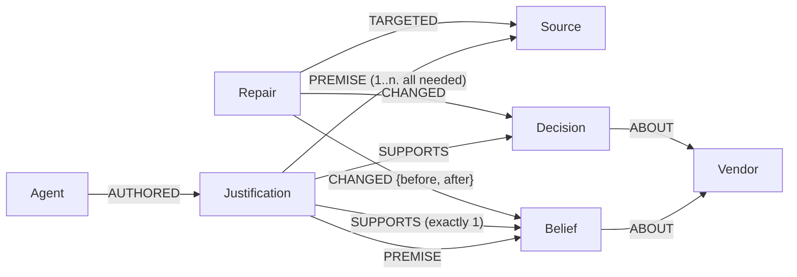

# Antidote

**Memory your AI agents can audit: a graph-native recovery layer for multi-agent memory,
built on FalkorDB.**

When agents share memory, one poisoned, retracted or outdated source can become a fact, then a
decision, then an action. Antidote records **why** every fact is believed, as a graph in
FalkorDB. So it can check documents before anyone decides, stop actions whose reasons no
longer hold, and remove exactly what rested on a bad source while keeping everything else.

- **Live demo:** https://antidote-yqk6.onrender.com (the first load may take a minute)
  · **Under the hood:** [/#/under-the-hood](https://antidote-yqk6.onrender.com/#/under-the-hood)
- **Demo video:** _link added at submission_
- **Tracks:** **02 Agent Memory and Coordination** (primary) · 01 Agents That Act on Connected Data
- **In plain words:** [docs/explained.md](docs/explained.md) explains every part, file and decision
- **Built for** Graph Hacks: Context for AI Agents (WeMakeDevs × FalkorDB), October 2026

The demo is a procurement case: two agents read ten documents and buy parts for a medical
robot from one of eight suppliers, and one page lies in hidden text written for AI. The live site replays **a real
run of gpt-oss-120b on Groq**, recorded word for word ([data/recordings/](data/recordings/));
no model is called on the site, and everything Antidote does runs live in FalkorDB.

---

## The problem

Agents that remember also absorb poisoned, retracted or outdated information, and it spreads:
a bad fact becomes a conclusion, the conclusion becomes a decision, and another agent acts on
it. Memory poisoning is on OWASP's 2026 agentic Top 10. The usual fixes both fail:

- **Delete the source:** everything derived from it survives.
- **Roll back to a snapshot:** everything good learned since is lost.

## The idea

1. **Every belief carries its reasons.** An agent cannot write a fact without the document it
   came from (quoted exactly) or the facts it concluded it from. A reason is a `Justification`
   node: it **holds** only if **all** its premises are valid, and a fact is **valid** if **any**
   of its reasons holds.
2. **What still holds is computed, never stored.** After every change, FalkorDB recomputes the
   least fixed point of that rule (below). It starts from "nothing holds", so two facts that
   justify each other cannot keep each other alive once their real source is gone.
3. **Documents are checked before anyone decides.** Hidden instructions for AI, facts an agent
   read in text a person cannot see, and claims that trusted documents contradict put a
   document **under review**: it counts for nothing, and the supplier it speaks for is
   suspended. Blacklisting stays a person's call.
4. **Actions are checked against today's memory.** At submit, approval and execution, an order
   with no reason left is **blocked**, even if a person approves; a large order resting on a
   certification that only unverified documents state is **held** until a trusted one confirms it.
5. **Repair is surgical and previewed.** Distrusting a source is first simulated on a
   `GRAPH.COPY`, then applied, checked against the preview and audited. Only what loses **all**
   support goes; anything with an independent reason stays.

### The rule, and the queries that compute it

```text
valid(Source)          = trust <> 'quarantined' AND not under review
holds(Justification)   = EVERY premise it cites is valid          (AND inside)
valid(Belief/Decision) = AT LEAST ONE justification for it holds  (OR across)
```

Reset every flag to false, then repeat one Cypher query until a round changes nothing
([app/support.py](app/support.py)):

```cypher
// Reset (one atomic query)
MATCH (s:Source) SET s.valid = (s.trust <> $quarantined AND s.review IS NULL)
WITH count(*) AS sources
MATCH (j:Justification) SET j.holds = false
WITH count(*) AS justifications
MATCH (n) WHERE n:Belief OR n:Decision SET n.valid = false
```

```cypher
// One round: (a) AND inside a justification, then (b) OR across justifications
MATCH (j:Justification)-[:PREMISE]->(p)
WHERE j.holds = false
WITH j, sum(CASE WHEN p.valid = true THEN 1 ELSE 0 END) AS valid_premises
WHERE valid_premises = j.premise_count
SET j.holds = true
WITH count(j) AS held
OPTIONAL MATCH (j:Justification)-[:SUPPORTS]->(n)
WHERE j.holds = true AND n.valid = false
WITH held, collect(DISTINCT n) AS newly_valid
FOREACH (n IN newly_valid | SET n.valid = true)
RETURN held, size(newly_valid) AS validated
```

### Where each decision is made

Every judgement is a Cypher query inside FalkorDB; Python never downloads the graph to work
out an answer itself. **All 59 queries are in [docs/cypher.md](docs/cypher.md)**, generated
from the code.

| Question | Answered by |
|---|---|
| Which facts, reasons and orders are still supported? | The fixed point above ([app/support.py](app/support.py)) |
| What may the agents read, and may the Buyer cite these facts? | `WHERE b.valid = true` queries that skip suspended suppliers ([app/memory.py](app/memory.py), [app/agents/buyer.py](app/agents/buyer.py)) |
| Does a document contradict a trusted one? Which suppliers does a review suspend? | The conflict check and the review write ([app/review.py](app/review.py), [app/memory.py](app/memory.py)) |
| Is this order blocked, held, or fine? Why? | The gate's queries; what it rests on is walked one level per query ([app/gate.py](app/gate.py)) |
| Would it survive losing a trusted origin? Is each certification confirmed by a trusted document? | Scenario queries plus the fixed point on a throwaway `GRAPH.COPY` ([app/gate.py](app/gate.py)) |
| What would distrusting this document change? | The fixed point on a copy, then a diff in Cypher ([app/repair.py](app/repair.py)) |
| How strong is each conclusion's evidence? | What-if worlds written onto one copy, combined by a final query ([app/evidence.py](app/evidence.py)) |

Python repeats queries until FalkorDB reports no change, applies the stakes policy (orders of
$5,000 or more, and irreversible ones, need a person), runs the agents and the hidden-text
scanner, and words the answers for people.

## What breaks without FalkorDB

Everything: FalkorDB is where every decision is made, so there is nothing to fall back to.

- The **Under the hood** page runs each capability through the real code with the exact Cypher
  and timings, then with no database behind the graph: **7 of 7 fail**. In a terminal:
  `python -m scripts.without_falkordb`.
- With FalkorDB unreachable, every `/api/*` endpoint answers `503`, the page shows an outage
  screen and recovers by itself. No order can be approved: the approval check *is* a query.
- Tested in [tests/test_without_falkordb.py](tests/test_without_falkordb.py); a test also checks
  that `app/` and `api/` never import the reference solver used to verify the Cypher.

## Graph data model



| Label | Properties |
|---|---|
| `Source` | `id`, `uri`, `title`, `trust` (trusted, unverified, quarantined), `origin` (lineage), `review` (why it is under review, or null), computed `valid` |
| `Belief` | `id`, `claim`, `standard` (a certification it says a supplier holds), `exclusive` (it says that supplier is the only one), `created_at`, computed `valid` |
| `Decision` | `id`, `kind` (shortlist, purchase_order), `summary`, `amount`, `reversible`, `state`, `note`, `approved_by`, `created_at`, computed `valid` |
| `Justification` | `id`, `kind` (extraction, inference, decision), `reasoning`, `quote`, `model`, `premise_count`, `created_at`, computed `holds` |
| `Agent` | `id`, `name`, `role` (researcher, buyer) |
| `Vendor` | `id`, `name`, `status` (suspended, blacklisted, or null), `status_by` (the document behind it) |
| `Repair` | `id`, `created_at`, `approved_by`, `revision` |
| `Meta` | `id: 'graph'`, `revision` (bumped by every write; rejects stale previews) |

A `Justification` node, not a plain "derived from" edge, because edges cannot say which
premises belong **together**: "A and B together imply C" and "A alone, or B alone, implies C"
look the same as edges, and differ as justifications.

**How the agents use it.** The Researcher writes facts with their quotes through
[app/memory.py](app/memory.py) (one atomic query per write; a reason citing a missing fact is
refused). The Buyer is prompted only with supported facts, and its plan is re-checked when it
is written. Agents can also use the graph as **MCP tools** ([app/mcp_server.py](app/mcp_server.py)):
`supported_beliefs`, `explain`, `check_order`, `preview_quarantine`, `record_extraction` and
more, with deliberately **no tool to approve** a repair or a purchase.

## Results

**An external test set: RippleEdits** (Cohen et al., TACL 2024): 15 cases loaded as a trusted
knowledge base plus one unverified source per edit; each edit is retracted in turn. Ground truth
comes from an independent solver ([tests/reference.py](tests/reference.py)) that shares no code
with the engine.

| Method | Exact cases | Left behind (should go) | Lost (must stay) |
|---|---|---|---|
| **Antidote** | **15 / 15** | **0** of 362 | **0** of 168 |
| Delete the source only | 2 / 15 | 362 | 0 |
| Roll back | n/a: the dataset has no timeline | | |

The facts and the must-not-change labels are theirs; the justification edges are our encoding
of their categories. On our own scenarios (the demo, and worlds with 20 and 100 vendors),
Antidote also leaves nothing behind and loses nothing, where rollback loses up to 396 good
facts and decisions. Details: [docs/benchmark.md](docs/benchmark.md).

**A scenario suite: 400 random cases** with 4 to 12 suppliers, attacks from AgentDojo's and
InjecAgent's published templates hidden the way documented incidents did (The Guardian, 2024;
Nikkei, 2025), plus cases built to make Antidote fail. A reviewer who approves everything
presses Approve; the result is judged against the truth ([scripts/scenario_suite.py](scripts/scenario_suite.py)).

| 400 random cases | With Antidote | Without |
|---|---|---|
| Right outcome | **296** | 116 |
| Bad order stopped, waiting for a person | **60** | 0 |
| Honest order waiting for a person | 25 | 0 |
| **Wrong supplier approved** | **17** | **284** |
| ...a supplier that manipulated the agents | **0** | 145 |

Antidote's 17 wrong orders come from failures built in on purpose: a wrong trusted registry, a
delivery-time lie, and a competitor framing an honest supplier. The cases are generated, so
this measures the checks across many situations, not a real model on real pages.

**A real model run.** Recorded with gpt-oss-120b ([scripts/record_run.py](scripts/record_run.py),
every prompt and reply verbatim, with provenance): the model recorded the hidden claim, and all
three checks caught the page before the Buyer decided; the numbers check refused 6 claims where
the model added product numbers its quotes don't contain. It also **found a gap in Antidote**:
after a false alarm, the model cited a certification directly and the hold let the order
through. The hold now checks every certification an order rests on (decision D64).

**Tests:** 190 (`python -m pytest`), including 25 random graphs (21 with cycles) checked against
the independent solver, the whole story over HTTP, the approval check at the endpoints, the
recorded run replayed answer for answer, and failing closed without FalkorDB.

## Where else this applies

Anywhere agents act on what they remember, and sources can turn out to be wrong:

- **Customer support:** answers and refunds built on a help article. When the article is
  corrected or withdrawn, exactly the answers and pending actions that relied on it are found
  and stopped; those also backed by the current policy stay.
- **Research assistants:** conclusions drawn from papers. When a paper is retracted, conclusions
  resting only on it fall, the rest stay, and the chain is shown for each.
- **Clinical and pharmacy support:** recommendations resting on a guideline, a lab value or a
  drug label. A superseded guideline or a recall blocks the orders that relied on it until a
  clinician reviews them.
- **Compliance, KYC and sanctions screening:** approve or block decisions resting on list
  entries. When a list is corrected, only the decisions that relied on the wrong entry reopen.
- **Security operations:** automated blocks based on threat-intelligence feeds. When an
  indicator turns out to be a false positive, the blocks resting only on it lift.
- **Personal assistants with long-term memory:** "I moved", "that's no longer my number". A
  correction removes exactly the memories and plans derived from the old fact.
- **Any agent that reads the web:** pages can hide instructions for AI. Checking documents before
  they count, and tracing what each answer rests on, applies directly.

## Run it locally

Requirements: Docker, Python 3.12, Node 22 or newer. About four minutes from clone to running
(3 min 41 s on our laptop with pip's cache warm, filmed in the demo video); no API key needed.

```bash
git clone https://github.com/Rohxn14/antidote.git
cd antidote
docker compose up -d                  # FalkorDB on :6379, FalkorDB Browser on :3000
python3.12 -m venv .venv              # Windows: py -3.12 -m venv .venv
source .venv/bin/activate             # Windows: .venv\Scripts\activate (Git Bash: source .venv/Scripts/activate)
pip install -r requirements.txt
cp .env.example .env
cd web && npm ci && npm run build && cd ..
python -m pytest -q                   # 190 tests
uvicorn api.server:app --port 8000    # open http://localhost:8000
```

More:

- `python -m scripts.scenario_suite` (the scenario suite) · `python -m scripts.benchmark`
  (the benchmark) · `python -m app.mcp_server` (the MCP server, stdio) ·
  `streamlit run ui/streamlit_app.py` (the Lab, with a Playground for your own worlds).
- **Real agents:** put `LLM_API_KEY` and `LLM_MODEL` (a Groq model with structured outputs, for
  example `openai/gpt-oss-120b`) in `.env` and pick **Live AI** in the app. To record a new run
  for replay: `python -m scripts.record_run` (every attempt is logged in
  `data/recordings/attempts.log`).
- **Inside the graph:** the FalkorDB Browser at http://localhost:3000, graph `antidote`.
- **FalkorDB Cloud:** put its host, port, username and password in `.env.cloud` and set
  `ENV_FILE=.env.cloud`. **Deploy:** [render.yaml](render.yaml) (one Docker service on Render;
  live AI stays off there); [.github/workflows/keepalive.yml](.github/workflows/keepalive.yml)
  pings it during judging.

## Tracks

- **02 Agent Memory and Coordination (primary):** memory that persists and updates (atomic
  writes, recomputed support); episodic, semantic and procedural memory (repair records, facts
  with reasons, the request's rules as facts); shared state between agents (the Buyer reads
  only what the Researcher's facts still support); separate memory per user (a private graph
  per case, behind an unguessable token).
- **01 Agents That Act on Connected Data:** multi-hop reasoning (support through chains of
  reasons); graph queries as agent tools and tool selection through MCP; actions based on what
  the graph shows (the approval check); explainable results ("Why this supplier?").

## Honest limitations

- Antidote follows the dependencies the agents recorded. A dependency they never recorded can
  leave contamination behind; exact quotes, existing ids and numbers checks limit this but
  cannot remove it.
- It cannot know if a trusted source is wrong: a wrong registry, or a delivery time no document
  contradicts, passes (measured in the scenario suite).
- The scanner knows published attack patterns and documented hiding techniques; a lie written
  in plain, visible text passes it, and the conflict check knows one kind of contradiction. The
  certification hold is the backstop.
- Suspension can be abused: a competitor can frame an honest supplier with hidden text, and it
  stays suspended until a person clears it.
- The live site replays one recorded model run; another run may answer differently. Live AI
  runs locally with a key.
- Support is recomputed over the whole graph after each change: fine for thousands of facts;
  millions would need incremental recomputation.
- All data is synthetic; every company is fictional.

## Prior art

Truth maintenance systems (1970s–80s) record justifications and retract conclusions when their
support goes; AGM belief revision formalises how beliefs should change; recent agent-memory work
(for example Kumiho, BeliefMem, Memward) adds graphs, revision or rollback. Antidote brings
justification-based support to **multi-agent memory and its actions**: computed inside a graph
database, previewed on a copy, enforced at approval time, and measured against an independent
oracle. The attack texts come from **AgentDojo** (Debenedetti et al., NeurIPS 2024; MIT licence:
its published templates, word for word, with a fictional goal; not its benchmark or code); the
external test set from **RippleEdits** (Cohen et al., TACL 2024; MIT licence; anonymised).

## AI assistance disclosure

This project was built with an AI coding assistant, **Claude Code (Claude Opus 5.5 by
Anthropic)**, as the hackathon rules allow, and its use is disclosed here. Rohan chose the
problem and wrote the project brief (the data model, the support rule, the gate policy, the
repair workflow, the required tests and the benchmark design), designed the scenario, made the
design decisions recorded in [docs/decisions.md](docs/decisions.md) (including the reviews that
led to the approval holds and the case builder), set the test expectations, typed
[app/centrality.py](app/centrality.py) himself, and reviewed, ran and verified the results,
including by hand on the live app. Claude proposed implementation options, wrote most of the
code and tests under that direction, and explained each part. Commits made with the assistant
carry a `Co-Authored-By` trailer.

## Project layout

```text
app/        the engine: support (fixed point), memory (writes), gate, repair, review (checks
            before deciding), evidence, agents, MCP server, case builder, recordings
api/        the web API (FastAPI): streams, actions, sessions; fails closed without FalkorDB
web/        the web app (React, TypeScript, React Flow)
scripts/    benchmark, scenario suite, record_run, export_cypher, without_falkordb, seed_demo
data/       synthetic documents, scripted answers, the recorded real run
docs/       explained.md, decisions.md (every design decision), cypher.md, benchmark.md,
            scenario_suite.md
tests/      190 tests and the independent reference solver
```
