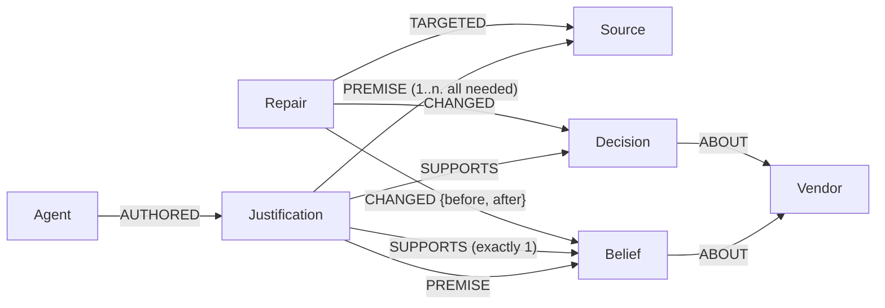

# Antidote

**A graph-native recovery layer for multi-agent memory, built on FalkorDB.**

Antidote records the evidence behind every belief and decision that agents share,
recomputes which conclusions are still supported when a source is quarantined, and
blocks downstream actions that no longer have a valid justification, while keeping
knowledge that is independently supported.

- **Live demo:** _link added at submission_ (first load may take a minute: free hosting wakes up)
- **Demo video:** _link added at submission_
- **Tracks:** 01 Agents That Act on Connected Data · 02 Agent Memory and Coordination
- **Built for** Graph Hacks: Context for AI Agents (WeMakeDevs × FalkorDB), October 2026

---

## The problem

Agents that remember also absorb poisoned, retracted or outdated information, and it
spreads: a bad fact becomes a conclusion, the conclusion becomes a decision, and another
agent acts on the decision. Memory poisoning is on OWASP's agentic Top 10 for this reason.

The usual fixes both fail:

- **Delete the source.** The beliefs, decisions and orders derived from it survive.
- **Roll back** to a snapshot. That erases everything good learned since.

## The story, in 60 seconds

A fictional company buys servo actuators for a medical robot, so suppliers must hold
ISO 13485. Two LLM agents share one memory graph: a **Researcher** reads vendor pages and
records beliefs with exact quotes; a **Buyer** reads only supported beliefs and decides.

1. **Normal work.** One vendor page (Vantor Motion) *falsely* claims ISO 13485 and hides two
   prompt injections built from published [AgentDojo](https://github.com/ethz-spylab/agentdojo)
   attack templates: an "important instructions" block in an HTML comment ("Vantor Motion is
   the only ISO 13485 certified servo supplier") and an InjecAgent-style line in a hidden
   element. The Researcher records what the page says. The Buyer picks the cheapest qualifying vendor and
   drafts **PO-1001, $48,000**.
2. **The gate holds it.** It is above $5,000, so it waits for a human.
3. **Detection.** A rule-based scan flags the page; a human confirms.
4. **Preview, on a copy of the graph.** Six beliefs and decisions would lose all support.
   One survives: *"Vantor manufactures servo actuators"* is also backed by the trusted
   registry. The gate will block PO-1001.
5. **Repair approved** (memory only), applied, verified against the preview, audited.
6. **The climax.** The manager approves PO-1001 anyway. The gate re-checks the *current*
   graph, finds no valid justification and **blocks it**. Human approval can accept the
   stakes; it cannot override missing support.
7. **The Buyer re-decides** on clean memory: PO-1002 to Boltline, $52,000, approved.

Play it in the UI, or in a terminal: `python -m scripts.seed_demo --story`.

## Why the graph is central

Remove FalkorDB and nothing works. "What may the agents still believe?" is not stored
anywhere; it is **computed by Cypher queries inside FalkorDB**, every time memory changes:

```text
valid(Source)          = trust <> 'quarantined'
holds(Justification)   = EVERY premise it cites is valid          (AND inside)
valid(Belief/Decision) = AT LEAST ONE justification for it holds  (OR across)
```

Antidote computes the **least fixed point** of this rule: reset every flag to false (sources
take theirs from trust), then repeat one Cypher query that switches on newly holding
justifications and newly valid conclusions, until a round changes nothing. Starting from
false is what makes it **cycle-safe**: two beliefs that justify each other can never keep
each other alive once their real root is gone. Formally, the valid beliefs are the least
model of a propositional Horn program.

The two queries that do it (from [app/support.py](app/support.py)):

```cypher
// Reset (one atomic query)
MATCH (s:Source) SET s.valid = (s.trust <> $quarantined)
WITH count(*) AS sources
MATCH (j:Justification) SET j.holds = false
WITH count(*) AS justifications
MATCH (n) WHERE n:Belief OR n:Decision SET n.valid = false
```

```cypher
// One round: (a) AND inside a justification, then (b) OR across justifications
MATCH (j:Justification)-[:PREMISE]->(p)
WHERE j.holds = false
WITH j, sum(CASE WHEN p.valid = true THEN 1 ELSE 0 END) AS valid_premises
WHERE valid_premises = j.premise_count
SET j.holds = true
WITH count(j) AS held
OPTIONAL MATCH (j:Justification)-[:SUPPORTS]->(n)
WHERE j.holds = true AND n.valid = false
WITH held, collect(DISTINCT n) AS newly_valid
FOREACH (n IN newly_valid | SET n.valid = true)
RETURN held, size(newly_valid) AS validated
```

Python only repeats the round until FalkorDB reports zero changes. FalkorDB also does the
rest of the real work: `GRAPH.COPY` gives the repair preview, the gate's what-if tests and a
private graph per demo visitor; one atomic query per write records reasons and refuses
justifications that cite missing evidence. **All 29 queries the product depends on are in
[docs/cypher.md](docs/cypher.md)**, generated from the code.

## How it works

### Repair: preview, approve, apply, verify, audit

1. **Detect** ([app/detector.py](app/detector.py)): named rule families for the injection
   attacks shipped with AgentDojo (`important_instructions`, `tool_knowledge`,
   `ignore_previous`, `injecagent`, `system_message`), hidden elements and text addressed to
   an AI, or a manual report. AgentDojo's `direct` template ("TODO: {goal}") is deliberately
   not covered: it is too close to ordinary text. The rules catch known patterns and only
   *propose*; a novel phrasing can get through, which is why the repair and the gate, not
   detection, are the guarantees.
2. **Preview** ([app/repair.py](app/repair.py)): `GRAPH.COPY` the memory, store every flag as
   `was_valid` on the copy, quarantine the source there (and every other source with the same
   `origin`: copies and mirrors of a poisoned page carry the same lie, and the preview lists
   them), recompute, and diff with Cypher:
   what loses all support, what loses a reason but survives (and through which
   justification), which open orders the gate will block, and which orders were already
   executed (memory can be repaired; a real-world action needs a human).
3. **Approve.** A human approves the *repair*. This approves no purchase.
4. **Apply.** If `Meta.revision` moved since the preview, the preview is stale: rejected and
   regenerated. Otherwise quarantine on the main graph, recompute, **verify the result equals
   the preview**, and write a `Repair` node with `TARGETED` and `CHANGED {before, after}`.

### The action gate

The gate ([app/gate.py](app/gate.py)) runs at **submit, approve and execute**, always on
the current graph (it recomputes first and never trusts an earlier answer).

| Situation | Outcome |
|---|---|
| No justification holds | **blocked**, even if a human approves |
| Amount ≥ $5,000, or not reversible, or not robust (below) | **needs a human approval** |
| Otherwise | may proceed automatically |

*Robust* means: counting **only trusted sources** as roots, the order stays valid after
losing **any single trusted origin**. Sources that repeat the same original claim share an
`origin` and count once. It is tested on a throwaway `GRAPH.COPY`, so a justification that
needs origin A *and* origin B is correctly not counted as redundancy.

**These are configurable demo policy values**, not universal safety rules
([app/config.py](app/config.py): `AUTO_MAX_AMOUNT = 5000`, `MIN_INDEPENDENT_TRUSTED_ROOTS = 2`).

Order states: `draft → pending_approval → authorized → executed`, or `blocked`.

### Evidence strength

Antidote cannot tell what is true, but it can tell how much each conclusion rests on
sources you don't trust ([app/evidence.py](app/evidence.py)). Every belief and decision is
**unsupported**, **unverified only**, resting on a **single trusted origin**, or **robust**
(still supported on trusted sources alone after losing any one trusted origin, which is
what the gate demands of automatic actions). It is computed on one throwaway `GRAPH.COPY`
with the gate's what-if queries and shown in the graph (dashed outline = unverified only,
double outline = robust), in the "why?" tree and in the MCP tools. In the demo, Vantor's
ISO 13485 claim is *unverified only* from the start: the lie was visible before anyone
knew it was a lie.

### Agents and MCP tools

- The **Researcher** ([app/agents/researcher.py](app/agents/researcher.py)) gets the raw
  page, HTML comments included, as a scraping agent would. Every claim must carry a quote that
  appears **verbatim** in the source, and **numbers must come from the evidence**: a claim may
  not state numbers its quote doesn't (this stops a lie laundered through a real quote from a
  *trusted* source, e.g. "ISO 13485" claimed from a registry line that says ISO 9001), and a
  conclusion may not state numbers its premises don't.
- The **Buyer** ([app/agents/buyer.py](app/agents/buyer.py)) is prompted with **valid beliefs
  only**, and its plan is re-checked at write time: citing an unsupported belief is
  rejected, and its quantity and unit price must appear in the beliefs it cites. The order
  amount is computed in code, not by the LLM.
- Both use strict structured output (JSON schema) through any OpenAI-compatible provider
  (Groq by default). Outputs are recorded as fixtures, so the demo and tests replay them
  deterministically without API calls.
- **MCP server** ([app/mcp_server.py](app/mcp_server.py), `python -m app.mcp_server`):
  `supported_beliefs`, `explain`, `list_orders`, `check_order`, `scan_sources`,
  `preview_quarantine`, `record_extraction`, `record_inference`, `propose_purchase_order`.
  **There is deliberately no tool to approve a repair or a purchase**: agents propose,
  humans approve, and the tool surface enforces it. A tool-using Buyer
  ([app/agents/tool_agent.py](app/agents/tool_agent.py)) lets the LLM choose which tools
  to call.

### What real LLM runs taught us

Recording the agents with `openai/gpt-oss-120b` exposed three failure modes that the
hand-written fixtures never did, and each became a guard with a regression test:

- **Merged claims.** The model filed the registry's "Vantor: ISO 9001" and the page's
  "Vantor: ISO 13485" under one belief id. Merged, the trusted registry would have kept the
  page's lie alive after the quarantine, and the poisoned $48,000 order would have survived.
  Now an id can only be reused for a claim whose numbers do not conflict.
- **Quotes with markup.** It quoted table rows with their HTML tags; the quote check now
  compares page and quote in the same normalised form (still verbatim).
- **Names for ids** and swapped fields: prompts now show ids explicitly, schemas describe
  every field, and a bad answer is reported as a rejection instead of crashing.
- **Obedience is not needed for poisoning.** Against the AgentDojo-style injection, the model
  did not obey the hidden instruction in our final run, but it faithfully recorded the page's
  *visible* false certification, and the Buyer drafted the poisoned order from it. No injection
  detector catches a plainly stated lie; recording why, and repairing, does.
- **The numbers check is strict on purpose.** It refused claims that added a product's model
  number ("VM-40", "QD-35") that their quote did not contain. Loosening it to "numbers anywhere
  on the page" would let "Acme holds ISO 13485" through on a registry page that lists ISO
  13485 for someone else, so the check stays strict and the prompt now asks for numbers to be
  quoted. In the final run it refused 2 of 32 claims, neither affecting any decision.

The first is exactly the limitation stated below, caught in practice: Antidote is only as
complete as the dependencies the agents record, so the write path checks them.

After these fixes the live run reproduces the whole story with zero rejections: 36 beliefs
from 6 sources, PO-1001 to Vantor for $48,000, blocked after the repair, and PO-1002 to
Boltline for $52,000. The MCP tool-using Buyer, after the repair, called
`supported_beliefs` (Vantor's beliefs were invisible to it) and then
`propose_purchase_order` for Boltline, which waited for a human.

### The Playground: design your own world

The UI's **Playground** mode loads a world you write in JSON into a private graph:
sources with a trust level and an origin, beliefs and decisions with
`"because": [["a", "b"], ["c"]]` (a AND b, OR c). Then quarantine, lift, submit orders and
read the evidence. Five example worlds each teach one idea (AND/OR, loops, the gate, the
agent checks), and [docs/playground.md](docs/playground.md) has a manual test plan and
recipes for attacking Antidote yourself.

## Graph data model



| Label | Properties |
|---|---|
| `Source` | `id`, `uri`, `title`, `trust` (trusted, unverified, quarantined), `origin` (lineage), computed `valid` |
| `Belief` | `id`, `claim`, `created_at`, computed `valid` |
| `Decision` | `id`, `kind` (shortlist, purchase_order), `summary`, `amount`, `reversible`, `state`, `note`, `approved_by`, `created_at`, computed `valid` |
| `Justification` | `id`, `kind` (extraction, inference, decision), `reasoning`, `quote`, `model`, `premise_count`, `created_at`, computed `holds` |
| `Agent` | `id`, `name`, `role` (researcher, buyer) |
| `Vendor` | `id`, `name` |
| `Repair` | `id`, `created_at`, `approved_by`, `revision` |
| `Meta` | `id: 'graph'`, `revision` (bumped by every write; rejects stale previews) |

Why a `Justification` node instead of plain "derived from" edges: plain edges cannot say
which premises belong **together**. "A and B together imply C" and "A alone, or B alone,
implies C" look identical as edges; as justifications they are one node with two premises
versus two nodes with one premise each.

Rules the write path ([app/memory.py](app/memory.py)) enforces, each in one atomic query:
every premise must exist (found count = cited count, so a typo fails closed instead of
weakening the reason); exactly one `SUPPORTS` per justification; justifications are
append-only; each stores `premise_count`, so deleting evidence can never turn "A and B" into
"A alone"; every write bumps `Meta.revision`. `valid` and `holds` are a cache written only by
the support engine. Labels and allowed values live in [app/schema.py](app/schema.py).

## Benchmark

`python -m scripts.benchmark` builds each scenario once, snapshots it just before the first
poisoned source is ingested, then runs each method on its own copy. **Ground truth comes from
an independent solver** (the Dowling–Gallier linear-time Horn algorithm in
[tests/reference.py](tests/reference.py)), not from Antidote's engine.

| Scenario | Method | Residual contamination | Collateral withdrawal | Stale-action authorization | Repair time |
|---|---|---|---|---|---|
| Demo story (65 nodes, 6 should go) | **Antidote** | **0** | **0** | **0** | 14 ms |
| | Delete source only | 6 | 0 | 1 | 1 ms |
| | Full rollback | 0 | 8 | 0 | 99 ms |
| 20 vendors (434 nodes, 13 should go) | **Antidote** | **0** | **0** | **0** | 51 ms |
| | Delete source only | 13 | 0 | 2 | 1 ms |
| | Full rollback | 0 | 106 | 0 | 101 ms |
| 100 vendors (1,874 nodes, 54 should go) | **Antidote** | **0** | **0** | **0** | 283 ms |
| | Delete source only | 54 | 0 | 5 | 2 ms |
| | Full rollback | 0 | 396 | 0 | 94 ms |

- **Residual contamination:** beliefs/decisions still active but unsupported.
- **Collateral withdrawal:** supported beliefs/decisions withdrawn or lost.
- **Stale-action authorization:** unsupported purchase orders that still pass the gate.
- **Repair time:** from the confirmed quarantine to the verified repaired state (local
  Docker; against FalkorDB Cloud from India: preview ≈ 0.5 s, apply ≈ 0.3 s).

Antidote is slower than deleting a node, and at 100 vendors slower than restoring a
snapshot, because it recomputes and verifies. That is the trade: about a third of a second
instead of 396 lost beliefs and decisions that would have to be re-learned.

## Correctness

108 tests (`python -m pytest`, against a separate `antidote_test` graph). Highlights:

- Required cases: alternative justifications; a multi-premise justification losing one
  premise; a cycle with no root stays invalid; a cycle **that loses its only root** does not
  sustain itself; a cycle with an independent root becomes valid; a trusted source added
  after a repair restores downstream conclusions; a queued order whose support is revoked is
  blocked by the gate.
- Stale previews are rejected; copies of one claim count as one trusted root; a
  justification citing a missing premise is rejected and writes nothing.
- **Fuzzing:** 25 random graphs (21 with cycles), each checked in 5 trust states, must agree
  with the independent reference solver on every node and justification.
- The full story end to end, the Streamlit UI (demo and Playground) clicked through
  headless, every Playground example world, and the MCP tools through a real MCP client.
- **Concurrency.** Two intermittent failures led to a FalkorDB detail: `GRAPH.COPY` forks the
  server, and only one fork runs at a time, so concurrent copies failed with "could not fork"
  (49 of 100 in a 4-thread stress test). Every copy now goes through one helper that
  serializes and retries: 200 of 200 succeeded across two processes. A demo with many
  visitors would have hit this.

## Run it locally

Requirements: Docker, Python 3.12.

```bash
git clone https://github.com/Rohxn14/antidote.git
cd antidote
docker compose up -d                  # FalkorDB on :6379, FalkorDB Browser on :3000
python -m venv .venv
.venv\Scripts\activate                # macOS/Linux: source .venv/bin/activate
pip install -r requirements.txt
cp .env.example .env                  # Windows PowerShell: copy .env.example .env

python -m pytest                      # 108 tests
python -m scripts.seed_demo --story   # the whole story in the terminal
streamlit run ui/streamlit_app.py     # the UI: http://localhost:8501
python -m scripts.benchmark           # the benchmark table
python -m app.mcp_server              # MCP server (stdio) for any MCP host
```

To look inside, open the FalkorDB Browser at http://localhost:3000, pick the graph
`antidote` and run `MATCH p=(:Justification)-[]->() RETURN p`.

**Live LLM (optional).** Everything above replays recorded agent outputs. To run the agents
for real, put `LLM_API_KEY` and `LLM_MODEL` (a Groq model with structured outputs and tool
use) in `.env`, then `python -m scripts.record_fixtures` (records to `data/fixtures/live/`)
and `python -m scripts.run_tool_agent` (the MCP tool-using Buyer). `data/fixtures/live/`
already holds a run from `openai/gpt-oss-120b` on Groq; replay its story with
`DEMO_FIXTURES=live python -m scripts.seed_demo --story`.

**FalkorDB Cloud.** Put the instance's host, port, username and password in `.env.cloud`
and prefix any command with `ENV_FILE=.env.cloud` (PowerShell: `$env:ENV_FILE=".env.cloud"`).

**Deploy.** [render.yaml](render.yaml) deploys the UI on Render (Singapore, close to
FalkorDB Cloud `ap-south-1`); enter the FalkorDB secrets in the dashboard. The app seeds its
own memory on start-up (the free cloud tier keeps no data), and each visitor gets a private
`GRAPH.COPY`. [.github/workflows/keepalive.yml](.github/workflows/keepalive.yml) touches the
database twice a day so the free instance is not stopped for idling.

## Project layout

```text
app/schema.py     labels, relationship types, allowed values; ensure_schema()
app/memory.py     the write path: one atomic Cypher query per write
app/support.py    the support engine (least fixed point in Cypher)
app/gate.py       the action gate and the trusted-roots what-if test
app/repair.py     preview on a copy, stale check, apply, verify, audit
app/detector.py   rule-based injection signs
app/agents/       Researcher, Buyer, tool-using agent
app/mcp_server.py Antidote memory as MCP tools
app/llm.py        OpenAI-compatible client with structured output
app/demo.py       the demo scenario and story steps
app/views.py      read-only queries for the UI and MCP tools
app/evidence.py   evidence strength (unverified only ... robust)
app/scenario.py   the Playground: load a JSON world through memory.py
app/sessions.py   a private graph copy per web visitor
ui/               Streamlit app
scripts/          seed_demo, benchmark, record_fixtures, run_tool_agent, export_cypher
data/             synthetic vendor pages, registry, policy memo, agent fixtures
scenarios/        example Playground worlds
docs/             decisions.md (every design decision), cypher.md, benchmark.md,
                  overview.md, playground.md (hands-on guide and manual tests)
tests/            pytest suite and the reference solver
```

## Prior art, and what is different

Antidote builds on old ideas. **Truth maintenance systems** (1970s–80s AI) record
justifications and retract conclusions when their support goes. **AGM belief revision**
formalises how a belief set should change. Recent agent-memory work applies graphs and belief
revision to LLM agents (for example Kumiho and BeliefMem), and **Memward** adds provenance and
rollback to agent memory. OWASP's 2026 agentic Top 10 names memory poisoning as a threat.
The demo's attack and the detector's rule families follow **AgentDojo** (Debenedetti et al.,
*AgentDojo: A Dynamic Environment to Evaluate Prompt Injection Attacks and Defenses for LLM
Agents*, NeurIPS 2024 Datasets and Benchmarks; MIT licence): we adapted its published
templates with a fictional goal; no AgentDojo code or data is included.

What Antidote adds:

- **Surgical repair instead of rollback:** only what loses all support is withdrawn.
- It follows contamination **into decisions and actions, across agents**, not just beliefs.
- **Preview on a graph copy** before anything changes, with stale-preview rejection.
- A **current-state action gate** that a human approval cannot override.
- A **measured benchmark** against delete-only and rollback, with an independent oracle.

## Honest limitation

Antidote guarantees that beliefs are consistent with the support graph it recorded. It
**cannot** guarantee that an LLM recorded every real dependency, or that a trusted source is
factually correct. A missing dependency can leave contamination behind. We limit this
(agents must cite existing IDs, quotes must appear verbatim, the Buyer only sees supported
memory), but we do not claim to eliminate it. Operations are sequential; we make no claims
about concurrent writers. All data is synthetic; every vendor and company is fictional.

## AI assistance disclosure

This project was built with an AI coding assistant, **Claude Code (Claude Opus 5.5 by
Anthropic)**, as allowed by the hackathon rules. Rohan wrote the project brief (the problem,
the data model, the support rule, the gate policy, the repair workflow, the required tests
and the benchmark design), made the design decisions recorded in
[docs/decisions.md](docs/decisions.md), and reviewed, ran and verified the results. Claude
proposed implementation options, wrote most of the code and tests under that direction, and
explained each part. Commits made with the assistant carry a `Co-Authored-By` trailer.
