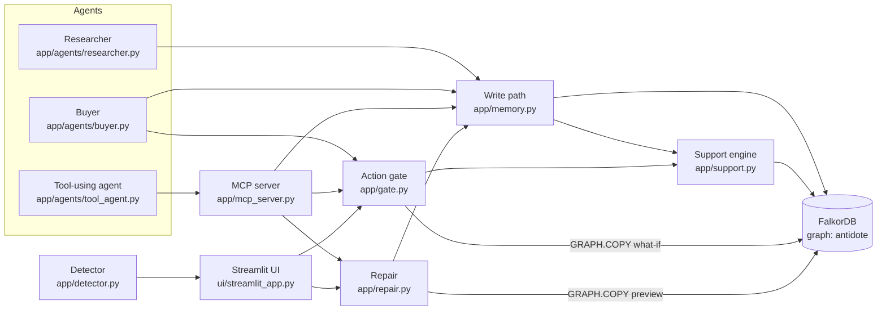

# Architecture overview

## The pieces

| Module | Responsibility |
|---|---|
| `app/schema.py` | The vocabulary: labels, relationship types, allowed values; `ensure_schema()` |
| `app/memory.py` | The only write path. One atomic Cypher query per write; bumps `Meta.revision`; rejects bad writes |
| `app/support.py` | The support engine: least fixed point of AND-inside / OR-across, in Cypher |
| `app/gate.py` | Order states; blocked / needs approval / auto; trusted-roots what-if on a copy |
| `app/repair.py` | Preview on a copy, stale-preview check, apply, verify, audit |
| `app/detector.py` | Rule-based injection signs; only proposes |
| `app/agents/*` | LLM proposes, code checks: quotes verbatim, premises valid, amounts computed |
| `app/mcp_server.py` | The graph as MCP tools; no approval tools |
| `app/views.py` | Read-only queries for the UI and MCP |
| `app/sessions.py` | A private `GRAPH.COPY` of the demo per web visitor |

## The four flows

**A write** (e.g. an agent records a justification): validate in Python (kind, non-empty
premises, quote for extractions) → one Cypher query that checks the target, the agent, the
premise count and the ID, then creates the node and all edges and bumps the revision →
full recompute.

**A recompute**: one reset query, then one round query repeated until it reports zero
changes. About as many rounds as the longest chain (4 in the demo).

**A repair**: recompute main → `GRAPH.COPY` → snapshot flags on the copy → quarantine on the
copy → recompute the copy → diff queries → human approves → revision check → quarantine on
main → recompute → compare with the preview → `Repair` audit node → drop the copy.

**A gate check** (submit, approve, execute): recompute → read the order → invalid? blocked.
Otherwise amount / reversibility → if still undecided, what-if copies: trusted sources only,
then minus each trusted origin.

## Judge Q&A prep

**"If I remove FalkorDB, does it still work?"** No. Whether anything is believed is computed
by the round query inside FalkorDB on every change; previews, what-ifs and per-visitor demos
are `GRAPH.COPY`; the write guards are Cypher. There is no copy of the logic in Python
(the only Python solver is the test oracle in `tests/`).

**"Why not just delete the poisoned source?"** Derived beliefs and decisions survive
(benchmark: 54 residual, 5 poisoned orders still pass). And deleting evidence from a
justification graph can make a reason *easier* to satisfy; Antidote stores `premise_count`
so deletion fails closed.

**"Why not roll back?"** It throws away good knowledge learned since (396 beliefs and
decisions at 100 vendors). Antidote withdraws only what loses all support.

**"How do you handle cycles?"** Least fixed point: everything starts false and only
switches on when a real root supports it, so a loop without a root stays off. Test:
`test_cycle_loses_its_only_root_and_does_not_sustain_itself`.

**"How do you know the Cypher is right?"** 25 random graphs, mostly cyclic, in 5 trust
states each, compared node by node with an independent linear-time Horn solver
(`tests/reference.py`) that shares no code or strategy with the engine.

**"What does 'two independent trusted roots' mean?"** Counting only trusted sources, the
order must stay valid after losing any one trusted origin. Copies share an origin and count
once; a reason that needs A *and* B fails when either goes, so it is not redundancy. Tested
on a throwaway copy rather than by counting.

**"Can an agent approve its own order?"** No. The gate needs a human approval above the
stakes threshold, and the MCP tool list has no approve tool at all. Even a human approval
cannot push through an order with no valid justification.

**"What if the graph changes between preview and approval?"** Every write bumps
`Meta.revision`; apply compares it with the preview's revision, rejects a stale preview and
regenerates it. After applying, the result must equal the preview exactly.

**"What can't it do?"** If an agent never recorded a dependency, Antidote cannot follow it.
If a trusted source is wrong, Antidote believes it. It is sequential, not built for
concurrent writers. Policy numbers are demo values.

**"Why a Justification node instead of edges?"** To record which premises belong together:
AND inside one justification, OR across several. Plain edges cannot tell the two apart.

**"Why full recompute instead of incremental?"** It is obviously correct and fast enough
(about 0.1 s against FalkorDB Cloud for the demo; 283 ms for five repairs on 1,874 nodes).
Incremental truth maintenance is where subtle bugs live.
